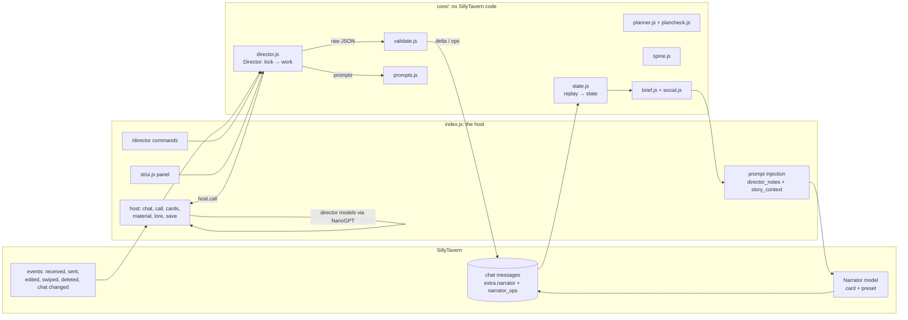

# Director map and audit (22 Nov 2026, after 0.2.0 and the replay cache)

This page records the November 22 architecture and audit snapshot. The line counts and original outcomes below refer to that snapshot. See [current verification and audit status](v2-verification.md) for rc.6.

## 1. The big picture



**One rule holds it together.** State is never stored. Every finding is written as a record on the message it came from, and state is rebuilt by replaying those records (`state.js replay`). Because of that, swiping, editing, deleting, branching and checkpoints come out right with no special handling.

- **Bound to a swipe:** observer readings (`extra.narrator.obs`), tracker findings (`track`) and director ops (`ops`, by `director`).
- **Kept across swipes:** player and setup ops (`narrator_ops`): edits, settles, profiles, roll-ups and redrafts.
- **Replay cache:** `Director.view()` caches the state for each chat revision. Callers get copies, and `sync()` clears the cache at the start of every pass.

## 2. One pass (`Director.kick → work`)

```mermaid
sequenceDiagram
    participant E as chat event
    participant D as Director
    participant O as observer
    participant T as spine tracker
    participant S as setup steps
    E->>D: kick() (single-flight; "again" re-runs)
    D->>D: sync(): reconcile ids, mark stale records, clear view cache
    par read replies
        D->>O: each unread reply, oldest first (backfill 6)
        O-->>D: delta → validateObservation → rec.obs
    and track the spine
        D->>T: a batch (4 replies or 20k chars; halved after a thinking-out)
        T-->>D: readings/marks → validateTracking → checkMarks → rec.track
    end
    D->>S: genre → profiles → spine → planner → conclusion → summariser → cleanup
    Note over S: each step has a cool-down after a failure;<br/>transient errors wait 20/60/180 s
```

| Step | Module and call | Runs when | Writes |
|---|---|---|---|
| observer | `observe` → `observerPrompt` | every unread reply | `rec.obs` (swipe-bound) |
| tracker | `track` → `trackerPrompt` + `trackCheckPrompt` | 4 replies or 20k characters waiting, or `/director track` | `rec.track` on the batch's last reply |
| genre | `ensureGenre` → `genrePrompt` | once per story, or `/director profile` | setup |
| profiles | `ensureProfiles` → `profilePrompt` | new or changed card, lorebook entry or story person; the player character from persona plus their lore entry | `profile` ops (setup) |
| spine | `ensureSpine` → `spinePrompt` (+ check) | after the arc; `/director spine`; `redraft` | `spine` op |
| planner | `maybePlan` → `arcPrompt` / `planPrompt` → `plancheck` | `planTrigger`: arc missing, queue empty, settled by the player, threads low (every 3+ turns), deviation, cadence; or `spineTrigger` | `plan` op (director) |
| conclusion | `maybeConclude` → `conclusionPrompt` | a milestone needs closing | spine op |
| summariser | `maybeRollUp` → `summariserPrompt` | director memory mode, enough unsummarised replies | roll-up (setup) |
| cleanup | `maybeCleanUp` → `cleanupPrompt` | every 10 turns, or early once there are enough facts it may remove | `facts-clean` (setup) |

Each turn costs about 2.3 director calls on average (measured on the 47-turn test chat). A plan turn costs 4–5: observer, planner, plan check and a profile.

## 3. Modules

| Module | Lines | Owns |
|---|---|---|
| `index.js` | ~920 | The host: SillyTavern events, cards and lore for profiles, prompt injection, `/director` commands, settings |
| `st/ui.js` | 877 | The panel: tabs for cast, plan, spine, facts and inspector, and editing (player ops) |
| `st/call.js` | ~70 | The model call: streaming, the no-streaming and temperature fallbacks, thinking-out detection |
| `st/providers.js` | 81 | Memory providers from other extensions (BaiBai and similar) |
| `core/director.js` | 914 | `Director`: the pass, model queue and retries, observe and track, setup steps, replay cache, player ops |
| `core/state.js` | 857 | `initialState`, `scan` / `reconcile`, `applyDelta` (observer), `applyOp` (every op kind), `replay`, `logOp`, settled, statuses, beat completion |
| `core/prompts.js` | 674 | Every system and user prompt: observer, tracker, plan, spine, arc, profile, genre, cleanup and conclusion. Also MOTIVE and PLAN_RULES |
| `core/validate.js` | 548 | Gates on observer and tracker output: quotes, caps, names, aliases and roles, weights, settled |
| `core/spine.js` | 441 | Spine model: endings, milestones, criteria, readings, observer and planner views, plan and edit merges |
| `core/plancheck.js` | 349 | Code checks on a plan (scripts the player, copied criterion, name clash…) and the rewrite request |
| `core/planner.js` | 294 | Validators for genre, arc, plan, spine and profile; `planTrigger`; `queuedBeatText` |
| `core/brief.js` | 284 | The narrator's `<director_notes>` (300-token cap) and `<story_context>` |
| `core/social.js` | 192 | Stats in words, the player character's line, comparisons, attempt and exchange detection |
| `core/text.js` | 173 | Quote matching (pronoun swaps, spoken short lines), names and roles, tag stripping |
| `core/agenda.js` | 165 | Character wants: validation, renewals, planner lines |
| `core/util.js`, `json.js`, `enums.js`, `vars.js`, `lore.js`, `record.js`, `memory.js` | 46–104 | Helpers, JSON extraction, constants, SillyTavern variables, the dynamic lorebook, summary views, memory modes |

## 4. What the narrator gets each turn

- **The card** (`card/src/description.md`) sets the Narrator's role. The **preset** (`card/src/preset.md`) owns the reply length guidance. Its defaults are about 500 tokens, with room for up to about 1,000 when the scene needs more detail.
- **`<story_context>`** (`buildStoryBlock`): premise, story profile, and summaries or chapters by memory mode.
- **`<director_notes>`** (`buildBrief`, capped at 300 tokens): scene, scene intent, clue, tension, spotlight, cast lines with wants, the player character's line, attempt, watch, settled, status.
- **Post-history line:** the rc.6 card preserves the active preset’s post-history prompt. The companion preset carries the writing and length guidance.
- **Genre craft entries:** lorebook entries switched on by flags.

## 5. Historical audit findings

The original A1–A10 findings are recorded below. See [current runtime audit status](v2-verification.md#2122-november-runtime-audits-against-rc6) for the source guards, split command grammar, and later browser coverage.

The original ranking is from commit `9561991`.

| # | Area | Finding | Impact | Suggested fix |
|---|---|---|---|---|
| A1 | Concurrency | `/director spine`, `redraft` and `rollup` call core methods outside `kick()`'s single-flight. They can overlap a background `ensureSpine` or `maybeRollUp`. | A paid call made twice; a second spine op that is then ignored | Queue commands through `kick()` with a pending-command slot |
| A2 | Swipes | A profile call that finishes after a swipe still logs its profile; the guard checks the epoch only. | A profile for a reply that is gone (removed at replay if the person is gone too) | Check, before logging, that the introducing reply is still current |
| A3 | Scene | The present list merges unless the location changes, so in a cut to another scene people stay "present" and become witnesses. | Facts known by people who weren't there | Reset the present list when the observer reports a new scene, or when the scene key changes |
| A4 | Death | "Mortally wounded" or a death told only in the facts never marks the person dead. | Dead people stay in play | Let the observer's `dead` cast change be suggested from fact kind "condition" plus death words, or flag it in the inspector |
| A5 | Voice | The card's "speaks to the reader" style and the profile's "second person" both use "you", and "you" resolves to the player character. | Mixed address and some quote misattribution | The genre profile picks one way of addressing the reader; the validator maps "you" only in second-person stories |
| A6 | Tracker | `trackMax` (halved batch size) is kept until a retry or chat change, not reset after a success. | Batches stay small for the rest of the session: more calls, each cheaper | Reset after N successful batches, or grow it back by one per success |
| A7 | Settled | Settled matters read from the story alone still go to the planner and the notes as closed. | A price-like story fact can be closed by mistake | Show only the player's own settled matters to the planner and notes; keep story ones in the inspector |
| A8 | Size | `index.js` (964 lines) and `director.js` (914) do several jobs each. | Harder to change safely | Split `host.call` into `st/call.js` and the commands into `st/commands.js`; split setup steps out of `Director` |
| A9 | Efficiency | `nextBatch` scans the whole chat on each of up to 20 loop turns. | O(chat) × 20 per pass; small next to replay | Scan once per tracking loop |
| A10 | Tests | No test exercises tracker batch sizing or the thinking-out halving; `host.call` streaming has no tests; the end-to-end checks were last run for 0.1.0. | Regressions there go unseen | Unit-test `nextBatch` with a fake chat; a fake `ConnectionManagerRequestService` for `host.call`; re-run `npm run e2e` |

**Checked and fine:**
- Replay after swipe, edit, delete and branch.
- The replay cache: its key covers text, swipe, hidden flag, records and ops, and callers get copies.
- Settled re-plan, ids and criteria closing.
- Role characters and the `named` change.
- Skipped milestones reopening.
- Hooks planted on every completion path.
- Retry waits held for every kick.
- Streaming error mapping.
